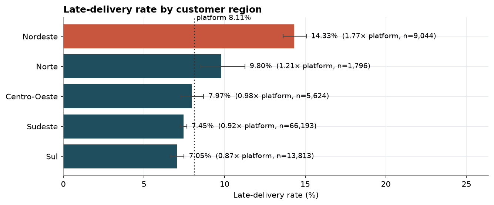
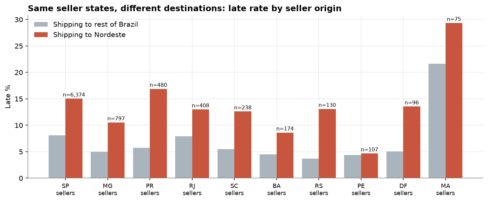
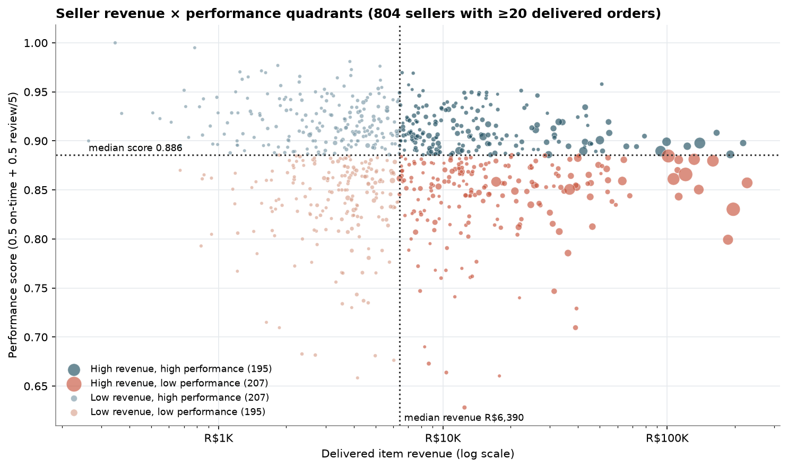
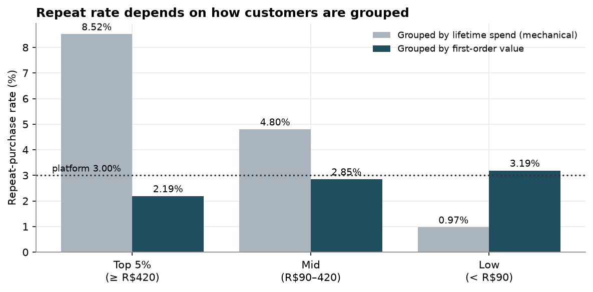

# Olist Command Center

An end-to-end SQL/Python analytics project on the Olist Brazilian e-commerce
dataset: order, seller, customer, product, payment, review, and logistics
data for a multi-seller marketplace, taken from raw CSVs through a
reproducible ETL pipeline into a dimensional star schema, then analyzed for
revenue performance, delivery reliability, seller/category performance,
customer behavior, and regional logistics root causes.

## Contributors

- **[Ashish Donth](https://github.com/Namunah1)** 
- **[SOHAM TANAJI RAUT](https://github.com/soham259)** 

## What this project does

- Loads and validates the 9 raw Olist CSVs (**1,550,922 rows** combined; ~1M of
  them are the geolocation lookup) into PostgreSQL, checking every file's
  columns and row count against a manifest before loading
- - Audits data quality across referential integrity, date sequencing, payment
  reconciliation, missing values, and duplicate keys. The latest reporting
  scorecard contains **36 checks: 27 PASS, 9 WARN, and 0 FAIL**; known exceptions
  are documented.
- Builds a dimensional star schema (3 fact tables, 5 dimensions) with
  validated grain and revenue reconciled to the cent
- Answers a defined set of business questions in SQL (foundational + window
  functions), with every KPI formally defined once and used consistently
  everywhere
- Segments sellers into a revenue × performance quadrant, and customers by
  spend tier (`sql/08_business_findings.sql`)
- Investigates a regional logistics pattern down to a supported conclusion
  (not just an observation)
- Runs two explicit, clearly-labeled what-if scenarios
- **81 automated tests** covering data quality, business findings, scorecard
  checks, visualizations, and notebook execution. All 81 passed in the latest local test run;
  one non-fatal warning was reported. See `docs/testing.md` for details.
- **Analysis notebook** — `notebooks/Olist_Analysis.ipynb` walks through every
  query, table, chart and result in order, saved with its outputs so it reads
  on GitHub without running anything
- **One script generates every chart and table** —
  `scripts/generate_visuals.py` writes 15 charts (PNG), 14 tables (CSV) and a
  single self-contained HTML report (`reports/report.html`), all read from the
  analytics views so the numbers match the pipeline and tests exactly

## Key findings

All figures below are reproduced by the pipeline from the supplied files and
pinned by tests. See `docs/audit_report.md` for how each was verified.

- **R$13.2M in revenue** (R$13,221,498.11, item price only) across **96,478
  delivered orders**, AOV R$137.04, steady growth from late 2016 through
  mid-2018 (dataset ends October 2018)
- **91.89% on-time delivery** platform-wide (8.11% late). The **Nordeste**
  region runs **14.33% late — 1.77× the platform rate** — and its worst states
  run **2–3×**: Alagoas 23.93% (2.95×), Maranhão 19.67% (2.42×). Lateness is
  elevated across every seller-origin state shipping there, pointing to a
  regional logistics pattern rather than one bad seller or category
  (`docs/root_cause_analysis.md`)
- **The high-revenue / below-median-performance seller quadrant is the
  platform's single largest revenue block**: 207 sellers, R$5.40M on the
  KPI-consistent definition (originally reported as 212 sellers / R$5.37M;
  the exact headcount is definition-sensitive, 206–213 across the variants
  tested, and the finding holds in all of them) — a retention/coaching
  opportunity rather than a removal case (`docs/seller_and_category_analysis.md`)
- **Repeat-purchase rate is 3.00% platform-wide and 8.52% in the top 5%
  lifetime-spend tier.** Caveat: most of that gradient is mechanical (repeat
  buyers accumulate lifetime spend); by *first-order* value, high spenders
  repeat slightly less (2.19% vs 3.19%). The top tier matters for its revenue
  share (29%), not because high spenders are proven to be more loyal
  (`docs/customer_analysis.md`)

Full findings, formulas, and evidence: see `docs/`.

## Analysis notebook

`notebooks/Olist_Analysis.ipynb` — the whole analysis in one notebook, saved
with outputs: SQL, table and chart for each question, followed by a
**Result** cell whose wording is generated from the numbers (nothing typed by
hand), and a closing summary that labels each finding as fact or association.

| Section | Contents |
|---|---|
| 1. Executive overview | KPI table (revenue, orders, AOV, late rate, review, customers, repeat rate, sellers, rows) |
| 2. Revenue over time | Monthly revenue + late-rate chart and table |
| 3. Logistics | Region and state late rates with 95% CIs, actual vs estimated days, delay distribution, seller origin × destination |
| 4. Sellers | Quadrant scatter, revenue by quadrant, quadrant summary, top-20 coaching candidates |
| 5. Customers | Spend tiers, repeat rate by lifetime spend vs first-order value |
| 6. Categories | Top categories, late rate vs review, freight burden, category table |
| 7. Payments | Payment mix chart and table |
| 8. Data quality | Status chart, row counts vs manifest, all 27 checks with PASS/WARN/FAIL |
| 9. Results summary | Every finding with its evidence level, and what is not claimed |

```bash
pip install -r requirements-dev.txt     # includes Jupyter
python scripts/run_pipeline.py          # once, to build the analytics views
jupyter notebook notebooks/Olist_Analysis.ipynb   # then Run All
```

## Charts and report

```bash
python scripts/generate_visuals.py      # after run_pipeline.py; ~15 seconds
```

Writes to `reports/` (committed, so the charts are viewable on GitHub):
`reports/report.html` (open by double-clicking — every chart and table in one
page), `reports/charts/*.png` and `reports/tables/*.csv`. Every rate is shown
with its sample size and a 95% confidence interval; groups too small to rank
are faded or flagged.

| # | Chart | Question it answers |
|---|---|---|
| 1 | Monthly revenue and late rate | How did revenue and reliability move over time? |
| 2–3 | Late rate by region / by state | Where are deliveries late, and how sure are we? |
| 4–5 | Actual vs estimated days; delay distribution | How much buffer do estimates carry? |
| 6 | Late rate by seller origin, to Nordeste vs elsewhere | Is Nordeste lateness about the destination or the sellers? |
| 7–8 | Seller quadrants; revenue by quadrant | Which sellers hold revenue but underperform? |
| 9–10 | Spend tiers; repeat rate under two groupings | Who are the valuable customers, and is the repeat gradient real? |
| 11–13 | Top categories; late vs review; freight share | Which categories disappoint, and where is freight heavy? |
| 14 | Payment mix | How do customers pay? |
| 15 | Data-quality status | Can the numbers be trusted? |






## Data

Source: Olist Brazilian E-Commerce Public Dataset (originally published on
Kaggle by Olist). Raw CSVs are **not committed to this repository** —
redistribution rights aren't clearly established, so `raw_data/*.csv` is
gitignored. See `data/README.md` for exact filenames, expected row counts,
and how to obtain the dataset yourself.

## Data grain

- One row per order item (`fact_order_items`) — the finest usable grain for
  revenue, since orders can have multiple items
- One row per order (`fact_orders`) — carries pre-aggregated measures
  (revenue, freight, payment total, review score, on-time flag) so
  downstream reporting doesn't have to re-derive them via risky joins
- One row per payment record (`fact_payments`) — separate from `fact_orders`
  because ~3% of orders have multiple payment rows (installment splits),
  which would silently inflate revenue if joined to items directly

Full relational and dimensional model, with the fan-out risk demonstrated
concretely: `docs/data_model.md`.

## Technical stack

- **PostgreSQL** — raw and analytics (star schema) layers
- **Python** (pandas, SQLAlchemy, psycopg2) — ingestion and pipeline
  orchestration
- **SQL** — all analysis, from foundational joins/aggregates through window
  functions
- **pytest** — 81 automated tests: 37 original + 24 added in the audit
  (all against the live database) + 19 for the visuals script (18 run without
  a database) + 1 that executes the notebook
- **matplotlib** — static charts for the report (`scripts/generate_visuals.py`)
- **Jupyter** — the analysis notebook (`notebooks/Olist_Analysis.ipynb`)
- **Node.js** (`docx` package) — generates the business-case Word document
  from `business_case/build_business_case.js`

No dbt, no BI dashboard tool. Both were deliberate scope decisions, not
gaps — see `docs/methodology.md`.

## Repository structure

```
olist-command-center/
├── README.md
├── requirements.txt          # pandas, sqlalchemy, psycopg2-binary (version ranges)
├── requirements-dev.txt      # + pytest
├── .env.example               # template for .env (OLIST_DB_URL)
├── .gitignore
│
├── data/
│   └── README.md              # dataset provenance, expected files, how to obtain
├── raw_data/                  # place the 9 source CSVs here (gitignored)
│
├── docs/
│   ├── methodology.md
│   ├── data_dictionary.md
│   ├── data_quality.md
│   ├── data_model.md
│   ├── sql_analysis.md
│   ├── kpi_dictionary.md
│   ├── etl_pipeline.md
│   ├── customer_analysis.md
│   ├── seller_and_category_analysis.md
│   ├── logistics_analysis.md
│   ├── root_cause_analysis.md
│   ├── scenario_analysis.md
│   ├── recommendations.md
│   ├── testing.md
│   ├── assumptions_and_limitations.md
│   ├── audit_report.md        # 2026-10 audit: issues, fixes, verification evidence
│   └── windows_runbook.md     # step-by-step Windows setup and run
│
├── sql/
│   ├── 01_raw_schema.sql
│   ├── 02_data_quality_audit.sql
│   ├── 03_constraints_and_indexes.sql
│   ├── 04_sql_foundation.sql
│   ├── 05_advanced_sql.sql
│   ├── 06_star_schema.sql
│   ├── 07_data_quality_scorecard.sql
│   ├── 08_business_findings.sql   # views behind the headline findings
│   └── 09_reporting_views.sql     # views read by the charts/report script
│
├── scripts/
│   ├── config.py              # single source of truth: DB URL, data folder, row-count manifest
│   ├── ingest_raw.py          # pipeline steps 1-4 only (raw layer)
│   ├── run_pipeline.py        # end-to-end: validate -> load -> constrain -> gate -> build -> scorecard -> export
│   ├── verify_schema.py       # pre-flight check of the 9 CSVs (exit code 1 on any problem)
│   └── generate_visuals.py    # all charts + tables + HTML report, from the analytics views
│
├── tests/
│   ├── conftest.py
│   ├── test_data_quality.py   # 37 tests (original suite), require a live database
│   ├── test_business_findings.py  # 12 tests (added in audit)
│   ├── test_scorecard_checks.py   # 12 tests (added in audit)
│   ├── test_generate_visuals.py   # 19 tests for the visuals script
│   └── test_notebook.py           # executes the notebook end to end
│
├── notebooks/
│   └── Olist_Analysis.ipynb   # every query, table, chart and result (saved with outputs)
│
├── reports/                   # generated by generate_visuals.py
│   ├── report.html            # everything in one page
│   ├── charts/                # 15 PNG charts
│   └── tables/                # 14 CSV tables
│
├── business_case/
│   ├── build_business_case.js
│   ├── package.json
│   └── Business_Recommendations.docx
│
└── logs/                      # pipeline run logs (gitignored contents)
```

## Reproducing this analysis

**Windows users:** follow `docs/windows_runbook.md` — it walks through
installing Python and PostgreSQL, configuring `.env`, and running each step
with expected output.

Short version (any OS):

```bash
# 1. Create and activate a virtual environment, install dependencies
python -m venv .venv
#    Windows (PowerShell):   .venv\Scripts\Activate.ps1
#    macOS / Linux:          source .venv/bin/activate
pip install -r requirements-dev.txt

# 2. Create a DEDICATED database (the pipeline drops/recreates the raw and
#    analytics schemas in it)
createdb -U postgres olist

# 3. Configure the connection: copy .env.example to .env and set your password
#    (default if no .env: postgres:postgres@localhost:5432/olist)

# 4. Put the 9 CSVs in raw_data/ (see data/README.md), then pre-flight check
python scripts/verify_schema.py

# 5. Run the full pipeline (~2 minutes): validate -> load -> constrain ->
#    quality gate -> star schema + finding views -> scorecard -> CSV export
python scripts/run_pipeline.py

# 6. Run the tests (81; `pytest -m "not db"` runs the 18 that need no database)
pytest -v

# 7. Generate every chart and table, plus reports/report.html
python scripts/generate_visuals.py

# 8. Open the analysis notebook (then Run All)
jupyter notebook notebooks/Olist_Analysis.ipynb
```

Execution order of the SQL files: the pipeline runs `01` → load → `03` →
`06` → `08` → `09` → `07`. `02`, `04` and `05` are read-only investigation scripts
to run yourself afterwards (`psql -U postgres -d olist -f sql/04_sql_foundation.sql`).

**Verification status:** On Windows, the analysis notebook executed successfully, 
the HTML report and its charts and tables were generated, and the latest automated 
test run passed all 81 tests with one non-fatal warning. The local environment used PostgreSQL 17.11. 
See `docs/audit_report.md` for the separate audit evidence and verification details.

## Troubleshooting

| Symptom | Likely cause | Fix |
|---|---|---|
| `password authentication failed` | Wrong password in `.env` | Edit `OLIST_DB_URL` in `.env` |
| `connection refused` / `could not connect` | PostgreSQL not running, or a different port | Start the PostgreSQL service; check the port your installer chose |
| `database "olist" does not exist` | Step 2 skipped | `createdb -U postgres olist` |
| `MISSING FILE` / `ROW COUNT MISMATCH` | CSVs not in `raw_data/`, renamed, or a different dataset revision | Run `python scripts/verify_schema.py` and compare with `data/README.md` |
| `ModuleNotFoundError: config` | Script run from an unexpected location | Run from the project root: `python scripts/run_pipeline.py` |

## Limitations

This project reports associations (e.g., late delivery ↔ lower review
scores, regional logistics patterns) as associations, not proven causes, and
makes no revenue-impact or ROI claims the data can't support. See
`docs/assumptions_and_limitations.md` for the full list, including data
gaps, scope boundaries, and known edge cases.
